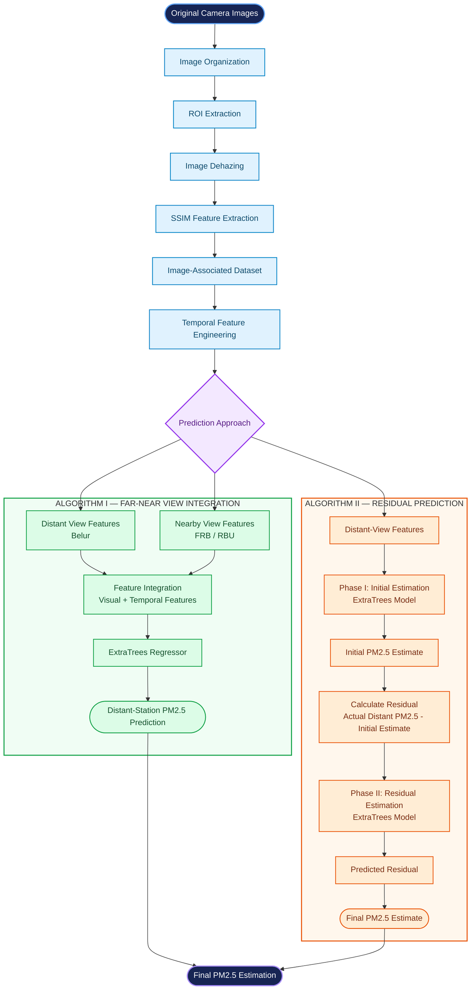

# PM2.5 Estimation from Distant Views Using Machine Learning

### Across the Miles with Machine Learning

<p align="center">
  
  
  
  
</p>

## Overview

Air pollution, particularly fine particulate matter (PM2.5), is a major environmental and public health concern. Conventional air quality monitoring stations are expensive to install and maintain, making widespread monitoring challenging.

This project investigates an image-based machine learning approach for estimating PM2.5 concentrations at different distances using images captured by a single camera.

The proposed methodology uses atmospheric visibility degradation as a visual indicator of particulate matter concentration. It combines image dehazing, Region of Interest (ROI) extraction, Structural Similarity Index Measure (SSIM), temporal feature engineering and machine learning regression.

Unlike conventional image-based approaches that estimate a single PM2.5 value from an entire image, this research explores the estimation of pollution levels at multiple distances using different camera views.

## Research Objectives

- Estimate PM2.5 concentrations using images captured from distant locations.
- Investigate the relationship between atmospheric visibility degradation and PM2.5 concentration.
- Extract meaningful visual features using predefined Regions of Interest (ROI).
- Investigate the contribution of SSIM towards PM2.5 prediction.
- Develop regression models incorporating nearby and distant visual information.
- Explore residual prediction to improve initial PM2.5 estimates.
- Evaluate model performance against ground-truth monitoring station measurements.

## Study Locations and Data Acquisition

Images were acquired using a Dahua 4 MP 32X Network PTZ Camera installed on the terrace of the Indian Statistical Institute (ISI), Kolkata.

Three monitoring locations were considered:

| Monitoring Station | Approximate Distance from ISI |
|---|---:|
| Rabindra Bharati University (RBU) | 2.6 km |
| Belur | 4 km |
| Ghusuri (Howrah) | 8 km |

PM2.5 measurements obtained from the corresponding monitoring stations were used as ground-truth data.

## Project Flow and Methodology

The research proposes two machine learning-based approaches for estimating PM2.5 concentrations at different distances using images captured by a single camera.

### Algorithm I: Far-Near View Integrated Approach

This approach integrates visual information from nearby and distant views to estimate the PM2.5 concentration at the distant monitoring station.

**Workflow:**

1. **Distant View Processing:** Capture the distant station image, select the corresponding Region of Interest (ROI), perform image dehazing and extract SSIM features.
2. **Nearby View Processing:** Capture the temporally aligned nearby station image and perform the same ROI selection, dehazing and feature extraction.
3. **Feature Integration:** Combine the image-derived features from both views with cyclically encoded date and time information.
4. **Regression:** Provide the combined features to an ExtraTrees regression model.
5. **Prediction:** Generate the estimated PM2.5 concentration for the distant monitoring station.

### Algorithm II: Residual Prediction-Based Approach

This approach uses a two-phase prediction framework to refine the initial PM2.5 estimate.

**Phase I – Initial Estimation**

1. Take the distant-view image as input.
2. Select the corresponding ROI.
3. Perform image dehazing and extract the ROI's SSIM features.
4. Use the extracted image features and temporal information as inputs to a regression model trained using ground-truth PM2.5 measurements from the nearby station.
5. Generate an initial PM2.5 estimate.

**Phase II – Residual Prediction**

1. Calculate the residual as the difference between the ground-truth PM2.5 concentration of the distant station and the initial PM2.5 estimate.
2. Train a machine learning regression model to estimate this residual.
3. Use the predicted residual to revise the initial PM2.5 estimate.
4. Obtain the final PM2.5 concentration estimate for the distant monitoring station.

The final estimate is expressed as:

\[
\text{Final PM}_{2.5}
=
\text{Initial PM}_{2.5}
+
\text{Predicted Residual}
\]

Both approaches use the ExtraTrees regression framework to estimate PM2.5 concentrations.


## Overall Workflow

The following flowchart illustrates the common image-processing pipeline and the two proposed PM2.5 prediction approaches.



## Repository Contents

### 1. Image Dehazing

**File:** `dehaze_production.py`

This script implements a pyramid-fusion-based image dehazing technique to enhance visibility and recover image details.

The implementation generates two image representations:

- White-balanced image.
- Contrast-enhanced image.

These representations are processed using multiple weight maps before multi-scale image fusion.

**Weight map generation**

Six weight maps are calculated for each image representation:

| Weight Map | Purpose |
|---|---|
| Visibility | Measures local visibility-related image variations |
| Visual Saliency | Extracts frequency and colour-based saliency information |
| Entropy | Measures local information content |
| Chromaticity | Captures colour-related information |
| Colorfulness | Measures local colourfulness |
| Luminance | Represents luminance variations |

**Multi-scale image fusion**

The implementation uses:

- Gaussian pyramid generation.
- Laplacian pyramid generation.
- Pyramid reduction and expansion.
- Weighted image fusion.
- Pyramid reconstruction.

The final enhanced image is generated through multi-scale fusion of the two processed image representations.

The main dehazing function is:

`pyramidFusionDehaze(img, ps)`

The script also includes batch processing to:

1. Read images from location-specific folders.
2. Apply the dehazing algorithm.
3. Save processed images with the `_d.png` suffix.
4. Preserve the original location-wise folder organization.

### 2. Image Data Processing and Dataset Preparation

**File:** `image_data_processing.py`

This script handles monitoring-station data cleaning and the generation of image-associated environmental datasets.

**Air quality data preprocessing**

Monitoring-station Excel files are processed to extract:

- Measurement start date.
- Measurement end date.
- Start time.
- End time.
- Relative Humidity (RH).
- Wind Speed (WS).
- Air Temperature (AT).
- PM2.5 concentration.

Data cleaning includes:

- Date and time conversion.
- Numerical conversion of environmental measurements.
- Removal of records containing missing PM2.5, RH, WS or AT values.

**Image and monitoring data alignment**

The `create_dataset()` function associates image filenames with corresponding monitoring-station records.

The image acquisition date and time are extracted from filenames and matched against the monitoring station's measurement intervals.

The resulting dataset contains:

| Column | Description |
|---|---|
| ImageFile | Name of the corresponding image |
| RH | Relative humidity |
| WS | Wind speed |
| AT | Air temperature |
| PM2.5 | Ground-truth PM2.5 concentration |

The processed datasets are exported in CSV format for subsequent feature extraction and machine learning experiments.

### 3. ROI Extraction and SSIM Calculation

**File:** `roitrial.py`

This script extracts predefined image regions and calculates structural similarity features using original and dehazed images.

**Processing steps**

1. Read the prepared image-associated CSV dataset.
2. Load the original image.
3. Load the corresponding dehazed image.
4. Convert both images into grayscale.
5. Apply morphological erosion to the dehazed grayscale image.
6. Extract the predefined ROI using pixel coordinates.
7. Calculate SSIM-based features.
8. Append the extracted features to the CSV dataset.

**ROI Configuration**

The implemented ROI uses the following image coordinates:

| Parameter | Value |
|---|---:|
| Starting row | 378 |
| Ending row | 1050 |
| Starting column | 1570 |
| Ending column | 2215 |

**Morphological Operation**

A rectangular structuring element of size 3 × 3 is used for morphological erosion.

The extracted features are stored in the CSV dataset and subsequently used as inputs for machine learning models.

### 4. Machine Learning Models

The research uses ExtraTrees regression models to estimate PM2.5 concentrations from image-derived features and temporal information.

Two notebooks contain the model implementations.

#### A. Algorithm I – Far-Near View Integrated Model

**Notebook:** `model_frb_belur.ipynb`

This implementation combines image-derived features from both the distant Belur view and the nearby FRB view to estimate the PM2.5 concentration at Belur.

**1. Input Dataset**

The model uses a combined CSV dataset containing image-derived features and acquisition date and time information.

**2. Temporal Feature Engineering**

Day, month, hour and minute information are converted into cyclic features using sine and cosine transformations.

The generated features include:

- `Day_sin`, `Day_cos`
- `Mon_sin`, `Mon_cos`
- `Hour_sin`, `Hour_cos`
- `Min_sin`, `Min_cos`

This encoding represents the periodic nature of time-related information.

**3. Feature Integration**

The model combines features from both camera views:

| Feature | Description |
|---|---|
| `Belur_SSIM` | SSIM feature from the distant Belur view |
| `Belur_ERODE` | Erosion-based SSIM feature from the Belur view |
| `FRB_SSIM` | SSIM feature from the nearby FRB view |
| `FRB_ERODE` | Erosion-based SSIM feature from the FRB view |
| Temporal Features | Cyclically encoded day, month and hour |

These features are used together as the model's input.

**4. Target Variable and Normalization**

The target variable is the PM2.5 concentration measured at Belur.

PM2.5 values are normalized using Min-Max normalization based on the training dataset.

**5. Model Training and Hyperparameter Optimization**

An ExtraTrees Regressor is used for regression.

The dataset is divided into training and testing subsets using an 80:20 split with `random_state=42`.

GridSearchCV is used for hyperparameter optimization. The search considers:

| Parameter | Values |
|---|---|
| `n_estimators` | 10–1010, in steps of 10 |
| `max_features` | `sqrt`, `log2`, 0.1, 0.2, 0.3, 0.5, 0.7, 1.0 |
| `bootstrap` | True, False |

The final model is configured with:

- `n_estimators = 410`
- `max_features = 1.0`
- `bootstrap = True`
- `random_state = 42`

**6. Prediction and Model Saving**

The trained model predicts normalized PM2.5 values for the training and testing datasets. The predictions are converted back to the original PM2.5 scale.

The trained model is saved using Joblib:

`etr_frb_belur.pkl`

The processed datasets are exported as:

- `frb_belur_train.csv`
- `frb_belur_test.csv`

#### B. Algorithm II – Residual Prediction-Based Model

**Notebook:** `model.ipynb`

This notebook implements the two-phase residual prediction framework. It first trains separate ExtraTrees models for the distant and nearby views and then uses the nearby-view prediction to estimate the residual for the distant station.

**1. Input Datasets**

The notebook uses two CSV datasets:

- `belur.csv`
- `belur_frb.csv`

The datasets contain image-derived features and corresponding PM2.5 measurements.

**2. Temporal Feature Engineering**

Day, month, hour and minute are extracted from image filenames.

Month names are converted into numerical values. Cyclic encoding is then applied using sine and cosine transformations.

The generated features include:

- `Day_sin`, `Day_cos`
- `Mon_sin`, `Mon_cos`
- `Hour_sin`, `Hour_cos`
- `Min_sin`, `Min_cos`

**3. Phase I – Initial PM2.5 Estimation**

Separate ExtraTrees regression models are trained using the distant Belur dataset and the nearby FRB dataset.

The input features include:

- `SSIM_ROI`
- `ERODE_SSIM_ROI`
- `Day_sin`
- `Day_cos`
- `Mon_sin`
- `Mon_cos`
- `Hour_sin`
- `Hour_cos`

The target variable is the normalized PM2.5 concentration.

Both datasets are divided into training and testing subsets using an 80:20 split with `random_state=42`.

GridSearchCV is used for hyperparameter optimization.

The selected ExtraTrees models are configured as follows:

| Model | `n_estimators` | `max_features` | `bootstrap` |
|---|---:|---:|---|
| Belur | 410 | 1.0 | True |
| Belur–FRB | 160 | 1.0 | False |

The trained models generate initial PM2.5 predictions for their respective locations.

The predictions are converted back to the original PM2.5 scale.

**4. Phase II – Residual Prediction**

The Belur and Belur–FRB datasets are merged using the common `ImageFile` column.

The residual is calculated as:

\[
\text{Residual}
=
\text{Actual Belur PM}_{2.5}
-
\text{Initial Belur PM}_{2.5}\text{ Estimate}
\]

The residual values are normalized using Min-Max normalization.

The second ExtraTrees model uses the following input features:

- Distant-view SSIM features.
- Cyclically encoded temporal features.
- Normalized nearby-station PM2.5 estimate.

The target variable is the normalized residual.

The selected residual model uses:

| Parameter | Value |
|---|---|
| `n_estimators` | 490 |
| `max_features` | 0.7 |
| `bootstrap` | False |
| `random_state` | 42 |

**5. Final PM2.5 Estimation**

The residual model predicts the correction required for the initial estimate.

The predicted residual is converted back to the original scale and added to the initial nearby-station estimate.

\[
\text{Final PM}_{2.5}
=
\text{Initial PM}_{2.5}\text{ Estimate}
+
\text{Predicted Residual}
\]

The notebook evaluates the final predictions using the R² score and exports the resulting training and testing datasets.

**6. Model Saving**

The trained models are saved using Joblib:

- `etr_belur.pkl`
- `etr_belur_frb.pkl`
- `etr_belur_res.pkl`

The final prediction datasets are exported as:

- `final_train_belur.csv`
- `final_test_belur.csv`

## Experimental Results

The research paper reports approximately 2,500 samples collected during March–April 2026 for the distant-view experiments.

An 80:20 training-testing split was used.

### Performance Comparison

The following results are reported in the research paper:

| Experiment | Approach | Location | R² | RMSE |
|---|---|---|---:|---:|
| 1 | Algorithm I | Belur | 0.90 | 2.78 |
| 2 | Algorithm I | Howrah | 0.88 | 4.09 |
| 3 | Algorithm II | Belur | 0.92 | 2.43 |
| 4 | Algorithm II | Howrah | 0.98 | 1.57 |

These are the paper-reported results and should not be interpreted as the output scores of every uploaded notebook.

### Key Findings

- The residual prediction approach performs better than the far-near integrated approach in the reported experiments.
- Combining visual features and temporal information improves prediction performance.
- The inclusion of nearby and distant visual information helps account for spatial variation in PM2.5 concentration.
- Distant-view images can provide useful information for estimating PM2.5 concentrations at locations beyond the immediate camera surroundings.

## Technologies and Libraries

| Category | Libraries / Tools |
|---|---|
| Programming Language | Python |
| Image Processing | OpenCV |
| Numerical Computing | NumPy |
| Data Processing | Pandas |
| Image Analysis | scikit-image |
| Scientific Computing | SciPy |
| Wavelet Processing | PyWavelets |
| Machine Learning | scikit-learn |
| Model Persistence | Joblib |
| Visualization | Matplotlib |
| Notebook Environment | Jupyter Notebook |
| Image Handling | Pillow |

## Installation

Clone the repository:

```bash
git clone https://github.com/your-username/pm25-estimation-from-distant-views.git

cd pm25-estimation-from-distant-views
```

Install the required Python packages:

```bash
pip install numpy pandas opencv-python matplotlib scipy scikit-image PyWavelets scikit-learn joblib Pillow openpyxl
```

## Running the Project

The processing stages should be executed in the following order:

**Step 1: Image Dehazing**

Run `dehaze_production.py` after configuring the original image directory and output directory.

**Step 2: Dataset Preparation**

Run `image_data_processing.py` after providing the monitoring-station Excel files and corresponding image directories.

**Step 3: ROI and SSIM Extraction**

Run `roitrial.py` after preparing the original and dehazed image directories and the corresponding CSV dataset.

**Step 4: Algorithm I – Far-Near View Integration**

Open `model_frb_belur.ipynb` in Jupyter Notebook and provide the combined dataset containing Belur and FRB image features.

Execute the notebook cells to perform temporal feature engineering, feature integration, model training, prediction and evaluation.

**Step 5: Algorithm II – Residual Prediction**

Open `model.ipynb` in Jupyter Notebook and provide the required Belur and Belur–FRB CSV datasets.

Execute the notebook cells to train the initial regression models, calculate residuals, train the residual prediction model and obtain the final PM2.5 estimates.

**Note:** The uploaded scripts and notebooks contain machine-specific file paths or rely on input files that must be supplied separately. These paths and filenames must be updated to match the local dataset directories.

## Dataset Availability

The original image dataset consists of a large collection of images captured from different monitoring locations.

Due to storage limitations, the original image collection is not included in this repository.

The repository focuses on sharing the image-processing implementation, dataset preparation code, feature extraction methodology and machine learning experiments.

Access to the corresponding image data and ground-truth monitoring-station measurements is required to reproduce the complete experiments.

## Future Scope

- Extend the dataset using long-term image acquisition.
- Investigate Vision Transformers and other deep learning architectures.
- Explore smartphone-based image acquisition.
- Extend the methodology to more than two locations at different distances.
- Investigate calibration and adaptation for practical deployment.

## Research Publication

**Title:** Determination of PM2.5 from Distant Views: Across the Miles with Machine Learning

**Authors:**
- Sarbani Palit
- Sagarnil Chakraborty
- Joydip Rakshit
- Priyasha Haldar
- Anushka Mukherjee

**Research Affiliations:**
- Indian Statistical Institute, Kolkata
- Academy of Technology
- Visva-Bharati, Santiniketan
- Sikkim Manipal Institute of Technology

## Acknowledgements

The authors acknowledge the infrastructural support provided by the Indian Statistical Institute and partial funding received from the West Bengal Pollution Control Board.

## References

1. Chakraborty, S., Palit, S. and Bhandari, H. (2024). *Can an Image Tell the Tale: Looking Beyond the Haze to Determine PM2.5 Concentration.* IEEE International Joint Conference on Neural Networks.

2. Bhandari, H. and Palit, S. (2021). *Looking Beyond the Haze: A Pyramid Fusion Approach.* ICONIP 2021.

3. Gu, K., Qiao, J. and Li, X. (2019). *Highly Efficient Picture-Based Prediction of PM2.5 Concentration.* IEEE Transactions on Industrial Electronics.

4. Zhang, K. et al. (2016). *Joint Face Detection and Alignment Using Multitask Cascaded Convolutional Networks.*

---

**Research Project:** Image-Based PM2.5 Estimation Using Machine Learning

**Institution:** Visva-Bharati, Santiniketan

**Research Collaboration:** Indian Statistical Institute, Kolkataation details, model configurations, and experimental results may not be publicly included due to project and research considerations.
